# Packing Module: Customer Drum Receiving, Packing List (Image Match) & Delivery Challan Workflow

**Document:** System Changes & Workflow Guide  
**Module:** Packing & Dispatch (`src/modules/packing`, `src/modules/dispatch`)  
**Status:** Implemented & Verified with Automated Integration Suite (`100% Tests Passing`)  
**Date:** October 2026  

---

## 1. Executive Summary & Context

In job-work cable manufacturing, the customer (e.g., **V-MARC INDIA LIMITED**) supplies not only raw materials (Aluminum wire rod, PVC/XLPE compound, GI strip, etc.) but also **empty drums** (wooden, steel, or corrugated) under a **Returnable Gate Pass (RGP) / Inbound Delivery Challan**.

When customer drums arrive at Mfolks Industries:
1. They must be received and tracked with the customer's inbound challan details (e.g., **Ref RGP No: 262740872**), drum numbers (e.g., `MF/01`, `MF/02`, `MF/03`, `MF/06`), and drum dimensions (`44X16X24`).
2. After cable production and stage testing are completed, finished cable lengths are packed into these specific customer drums.
3. A formal **Packing List** is generated that matches the company's real-world document structure (as shown in the provided scanned document image).
4. An **Outbound Delivery Challan** (e.g., `MF/DC/408`) and Invoice (e.g., `2025-26/RJ/JW/337`) are generated to accompany the physical dispatch.

This document details all code changes made across models, validation, services, controllers, routes, and tests, and explains how they enhance the end-to-end operational flow.

---

## 2. Scanned Image Analysis & System Alignment

### 2.1 Image Header & Metadata Match
| Scanned Document Field | Description in Scanned Image | System Property / Schema Field |
|---|---|---|
| **Company Header** | MFOLKS INDUSTRIES PRIVATE LIMITED<br>F-279 A, RIICO Industrial Area, Chopanki, Tapukara, Alwar, Rajasthan - 301707<br>GSTIN: 08AAOCM2650D1ZI, PAN: AAOCM2650D, CIN: U27320DL2021PTC376425 | Populated from company configuration / document template renderer in `getPackingListDocument` |
| **Document Title** | `PACKING LIST` | Header title in JSON and print views |
| **Customer Name** | `V-MARC INDIA LIMITED` | Populated from `CustomerModel.name` via `customerId` |
| **Work Order & Dtd** | `MF-2026-01 Dtd` | `workOrderNumber` & `workOrderDate` |
| **Size** | `4CX35 SQMM A2XFY` | `sizeDescription` (e.g. core count, cross-section, cable type) |
| **Date** | `17-08-2026` | `packingDate` |
| **Invoice No.** | `2025-26/RJ/JW/337` | `invoiceNumber` |
| **Challan No.** | `MF/DC/408` | `challanNumber` |
| **Packing No.** | `MF/PL/389` | `packingListNumber` |

### 2.2 Table Grid & Line Item Match
| Image Column | Image Sample Value | System Model Field (`PackingListLineModel`) |
|---|---|---|
| **S.NO** | `1`, `2`, `3`, `4` | `sequenceNumber: number` |
| **D.NO** | `MF/01`, `MF/02`, `MF/03`, `MF/06` | `drumNumber: string` (linked to `drumId`) |
| **LENGTH BOTTOM** | `0` | `lengthBottom: number` |
| **LENGTH TOP** | `495`, `495`, `499`, `508` | `lengthTop: number` |
| **LENGTH TOTAL** | `495`, `495`, `499`, `508` (Total: `1997.0`) | `lengthTotal: number`, total sum stored in `totalLengthMeters` |
| **DRUM SIZE** | `44X16X24` | `drumSize: string` |
| **Ref RGP No** | `262740872` | `refRgpNo: string` (inbound customer challan number) |
| **TYPE** | *(optional type code)* | `drumType: string` |
| **REMARK** | `STD.LENGNTH` | `remarks: string` |
| **Footer** | `For MFOLKS INDUSTRIES PRIVATE LIMITED` | Signature block in rendered printable document |

---

## 3. Summary of Files Changed & Created

| File | Type of Change | Key Modifications |
|---|---|---|
| [`src/modules/packing/drum.model.ts`](file:///e:/Mfolks_BOM/src/modules/packing/drum.model.ts) | Model Update | Added `refRgpNumber`, `inboundChallanId`, `inboundChallanNumber`, and `receivedDate` to track the incoming challan with which customer drums arrived. Added `packingListId` to associate packed drums. |
| [`src/modules/packing/drum-movement.model.ts`](file:///e:/Mfolks_BOM/src/modules/packing/drum-movement.model.ts) | Model Update | Added movement types `'INBOUND_RECEIPT'`, `'PACKING'`, and `'UNPACKED'` to track complete lifecycle movements of empty and packed drums. |
| [`src/modules/packing/packing-list.model.ts`](file:///e:/Mfolks_BOM/src/modules/packing/packing-list.model.ts) | Model Update | Added `invoiceNumber`, `challanNumber`, `sizeDescription`, `workOrderNumber`, `workOrderDate`, and `deliveryChallanId` to store all headers matching the image. |
| [`src/modules/packing/packing-list-line.model.ts`](file:///e:/Mfolks_BOM/src/modules/packing/packing-list-line.model.ts) | Model Update | Added `sequenceNumber`, `drumNumber`, `lengthBottom`, `lengthTop`, `lengthTotal`, `drumSize`, `refRgpNo`, and `remarks` to align with the table layout. |
| [`src/modules/dispatch/outbound-challan.model.ts`](file:///e:/Mfolks_BOM/src/modules/dispatch/outbound-challan.model.ts) | Model Update | Made `dispatchId` optional to allow direct creation of Outbound Delivery Challans from Packing Lists (`packingListId`). Added `refRgpNumber` and `invoiceNumber`. |
| [`src/modules/packing/packing.validation.ts`](file:///e:/Mfolks_BOM/src/modules/packing/packing.validation.ts) | Validation Update | Added `receiveCustomerDrumsSchema`, `createPackingListSchema` (with image-matching fields), and relaxed strict enum checks to support free-form drum sizes and types. |
| [`src/modules/packing/packing.service.ts`](file:///e:/Mfolks_BOM/src/modules/packing/packing.service.ts) | Core Logic Update | Added `receiveCustomerDrums`, `createPackingList`, `packPackingList`, `cancelPackingList`, `getPackingListDocument`, and `generateChallanFromPackingList`. Integrated ACID `TransactionUtil.runInTransaction` with automatic retry on transient locks. |
| [`src/modules/packing/packing.controller.ts`](file:///e:/Mfolks_BOM/src/modules/packing/packing.controller.ts) | Controller Update | Exposed endpoints for receiving customer drums, packing, document preview, and challan generation. |
| [`src/modules/packing/packing.routes.ts`](file:///e:/Mfolks_BOM/src/modules/packing/packing.routes.ts) | Routing Update | Registered `/api/v1/packing/drums/receive-customer-drums`, `/api/v1/packing-lists/:id/pack`, `/api/v1/packing-lists/:id/cancel`, `/api/v1/packing-lists/:id/document`, and `/api/v1/packing-lists/:id/generate-challan`. |
| [`tests/integration/customer-drums-and-packing-image.test.ts`](file:///e:/Mfolks_BOM/tests/integration/customer-drums-and-packing-image.test.ts) | Integration Suite | Comprehensive automated integration test covering customer drum inbound receipt, packing list creation, document rendering matching the image, drum status transition to PACKED, and outbound challan generation. |

---

## 4. How These Changes Change the Operational Flow

### 4.1 Previous Flow vs. New Flow

```mermaid
graph TD
    subgraph Previous Flow
        P1[Customer Sends Material Only] --> P2[Production Output created]
        P2 --> P3[Internal Drums assigned manually]
        P3 --> P4[Generic Dispatch without RGP linkage]
    end

    subgraph New Image-Aligned Flow
        N1[Customer Sends Raw Material + Empty Drums with RGP Challan] --> N2[Step 1: Receive Customer Drums with Inbound Challan]
        N2 --> N3[Drums stored in warehouse as AVAILABLE with Ref RGP No]
        N3 --> N4[Step 2: Multi-Stage Machine Production & Output]
        N4 --> N5[Step 3: Create Packing List matching Scanned Image layout]
        N5 --> N6[Step 4: Pack & Finalize - Drums transition to PACKED]
        N6 --> N7[Step 5: Generate Outbound Delivery Challan & Invoice Link]
        N7 --> N8[Step 6: Printable Document Rendered for Truck & Customer Handover]
    end
```



---

## 5. Step-by-Step Technical Workflow & API Payloads

### Step 1: Receiving Customer Drums with Inbound Challan (RGP)
When the customer's truck arrives with empty drums and an RGP / Delivery Challan, the stores/packing supervisor logs them into the system:

- **Endpoint:** `POST /api/v1/packing/drums/receive-customer-drums`
- **Request Payload:**
```json
{
  "customerId": "67b0d8aa123...",
  "customerChallanNumber": "262740872",
  "customerChallanDate": "2026-08-10",
  "vehicleNumber": "RJ-02-GB-4512",
  "transporter": "V-Marc Logistics",
  "lrNumber": "LR-98765",
  "drums": [
    { "drumNumber": "MF/01", "drumSize": "44X16X24", "drumType": "WOODEN", "tareWeightKg": 150, "remarks": "Good condition" },
    { "drumNumber": "MF/02", "drumSize": "44X16X24", "drumType": "WOODEN", "tareWeightKg": 150, "remarks": "Good condition" },
    { "drumNumber": "MF/03", "drumSize": "44X16X24", "drumType": "WOODEN", "tareWeightKg": 150, "remarks": "Good condition" },
    { "drumNumber": "MF/06", "drumSize": "44X16X24", "drumType": "WOODEN", "tareWeightKg": 150, "remarks": "Good condition" }
  ]
}
```
- **What Happens in System:**
  1. An `InboundChallan` document is generated with owner `CUSTOMER`, type `RECEIVED`, and challan number `262740872`.
  2. Four `Drum` documents are created with:
     - `ownership: 'CUSTOMER_SUPPLIED'`
     - `status: 'AVAILABLE'`
     - `refRgpNumber: '262740872'`
     - `inboundChallanId: inboundChallan._id`
  3. Four `DrumMovement` audit records are created with type `INBOUND_RECEIPT`.

---

### Step 2: Production & Stage Testing
The cable (`4CX35 SQMM A2XFY`) is manufactured across drawing, stranding, extrusion, and armouring machines. The final inspection/testing produces tested cable length (e.g. 2,000 meters in WIP/FG warehouse).

---

### Step 3: Create Packing List (Draft) Matching Scanned Image
The packing supervisor assigns the produced cable lengths into the customer's empty drums:

- **Endpoint:** `POST /api/v1/packing-lists`
- **Request Payload:**
```json
{
  "packingListNumber": "MF/PL/389",
  "workOrderId": "67b0d8bb456...",
  "workOrderNumber": "MF-2026-01",
  "workOrderDate": "2026-08-15",
  "sizeDescription": "4CX35 SQMM A2XFY",
  "invoiceNumber": "2025-26/RJ/JW/337",
  "challanNumber": "MF/DC/408",
  "customerId": "67b0d8aa123...",
  "packingDate": "2026-08-17",
  "lines": [
    {
      "sequenceNumber": 1,
      "drumId": "67b0d8cc001...",
      "drumNumber": "MF/01",
      "lengthBottom": 0,
      "lengthTop": 495,
      "lengthTotal": 495,
      "drumSize": "44X16X24",
      "refRgpNo": "262740872",
      "remarks": "STD.LENGNTH"
    },
    {
      "sequenceNumber": 2,
      "drumId": "67b0d8cc002...",
      "drumNumber": "MF/02",
      "lengthBottom": 0,
      "lengthTop": 495,
      "lengthTotal": 495,
      "drumSize": "44X16X24",
      "refRgpNo": "262740872",
      "remarks": "STD.LENGNTH"
    },
    {
      "sequenceNumber": 3,
      "drumId": "67b0d8cc003...",
      "drumNumber": "MF/03",
      "lengthBottom": 0,
      "lengthTop": 499,
      "lengthTotal": 499,
      "drumSize": "44X16X24",
      "refRgpNo": "262740872",
      "remarks": "STD.LENGNTH"
    },
    {
      "sequenceNumber": 4,
      "drumId": "67b0d8cc004...",
      "drumNumber": "MF/06",
      "lengthBottom": 0,
      "lengthTop": 508,
      "lengthTotal": 508,
      "drumSize": "44X16X24",
      "refRgpNo": "262740872",
      "remarks": "STD.LENGNTH"
    }
  ]
}
```
- **Validation & Calculation:**
  - Auto-computes `totalLengthMeters`: $495 + 495 + 499 + 508 = 1997.0\text{ m}$.
  - Auto-computes `totalDrums`: $4$.
  - Saves in `DRAFT` status so line values can be reviewed.

---

### Step 4: Finalize & Pack Drums
When physical winding onto the drums is completed on the factory floor, the supervisor finalizes the packing list:

- **Endpoint:** `POST /api/v1/packing-lists/:id/pack`
- **ACID Transaction Execution:**
  - Changes `PackingList.status` from `'DRAFT'` to `'PACKED'`.
  - Atomically locks each drum, updates `drum.status = 'PACKED'`, `drum.cableLengthMeters = line.lengthTotal`, and links `drum.packingListId = packingList._id`.
  - Records individual `PACKING` drum movements in `DrumMovementModel`.
  - Protected by `TransactionUtil.runInTransaction` to guarantee consistency and automatic retry on transient locks.

---

### Step 5: Render Printable Document Matching Scanned Image
For factory records and customer printouts:

- **Endpoint:** `GET /api/v1/packing-lists/:id/document`
- **Response Structure:**
```json
{
  "company": {
    "name": "MFOLKS INDUSTRIES PRIVATE LIMITED",
    "address": "F-279 A, RIICO Industrial Area, Chopanki, Tapukara, Alwar, Rajasthan, India - 301707",
    "gstin": "08AAOCM2650D1ZI",
    "pan": "AAOCM2650D",
    "cin": "U27320DL2021PTC376425"
  },
  "documentTitle": "PACKING LIST",
  "customerName": "V-MARC INDIA LIMITED",
  "workOrderNumber": "MF-2026-01",
  "workOrderDate": "2026-08-15",
  "size": "4CX35 SQMM A2XFY",
  "date": "17-08-2026",
  "invoiceNumber": "2025-26/RJ/JW/337",
  "challanNumber": "MF/DC/408",
  "packingNumber": "MF/PL/389",
  "table": [
    { "sNo": 1, "dNo": "MF/01", "lengthBottom": 0, "lengthTop": 495, "lengthTotal": 495, "drumSize": "44X16X24", "refRgpNo": "262740872", "type": "WOODEN", "remark": "STD.LENGNTH" },
    { "sNo": 2, "dNo": "MF/02", "lengthBottom": 0, "lengthTop": 495, "lengthTotal": 495, "drumSize": "44X16X24", "refRgpNo": "262740872", "type": "WOODEN", "remark": "STD.LENGNTH" },
    { "sNo": 3, "dNo": "MF/03", "lengthBottom": 0, "lengthTop": 499, "lengthTotal": 499, "drumSize": "44X16X24", "refRgpNo": "262740872", "type": "WOODEN", "remark": "STD.LENGNTH" },
    { "sNo": 4, "dNo": "MF/06", "lengthBottom": 0, "lengthTop": 508, "lengthTotal": 508, "drumSize": "44X16X24", "refRgpNo": "262740872", "type": "WOODEN", "remark": "STD.LENGNTH" }
  ],
  "summary": {
    "totalDrums": 4,
    "totalLengthTotal": 1997.0
  },
  "footer": {
    "signatory": "For MFOLKS INDUSTRIES PRIVATE LIMITED"
  }
}
```

---

### Step 6: Generate Outbound Delivery Challan
When the dispatch vehicle is loaded:

- **Endpoint:** `POST /api/v1/packing-lists/:id/generate-challan`
- **Request Payload:**
```json
{
  "challanNumber": "MF/DC/408",
  "invoiceNumber": "2025-26/RJ/JW/337",
  "vehicleNumber": "RJ-02-GB-9999",
  "transporterName": "V-Marc Logistics",
  "lrNumber": "LR-DISP-408"
}
```
- **What Happens in System:**
  1. An `OutboundChallan` is created with `challanNumber: 'MF/DC/408'`, `invoiceNumber: '2025-26/RJ/JW/337'`, and `refRgpNumber: '262740872'`.
  2. The delivery challan is directly linked back to `PackingList._id`.
  3. Drum movements are ready for gate dispatch.

---

## 6. Verification & Automated Test Results

The entire workflow has been proven and validated using automated end-to-end integration tests:
- **Test File:** [`tests/integration/customer-drums-and-packing-image.test.ts`](file:///e:/Mfolks_BOM/tests/integration/customer-drums-and-packing-image.test.ts)
- **Scenarios Tested:**
  1. Receiving 4 customer empty drums with Inbound Challan / Ref RGP No `262740872`.
  2. Generating Packing List `MF/PL/389` matching all image headers and line columns.
  3. Finalizing/packing drums and checking status updates to `PACKED`.
  4. Rendering JSON printable document format matching the scanned image.
  5. Generating Outbound Delivery Challan `MF/DC/408` linking invoice `2025-26/RJ/JW/337`.
- **Suite Result:** **5 of 5 tests passed (100% passing)**.
