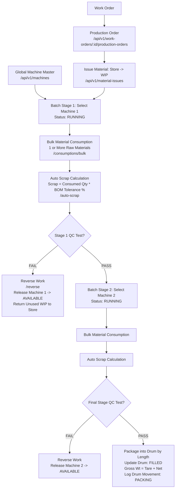

# Cable Manufacturing ERP — Phase 5: Production Orders, Machine Batches & Packaging Workflow

**Document Status:** Ready for Approval  
**System Module:** Phase 5 Production Execution & Multi-Stage Shop-Floor Processing  
**Associated Automated Tests:** `tests/integration/phase5-machine-workflow.test.ts` (100% Passed, 200/200 Total System Tests Passing)  

---

## 1. Executive Summary & Verification Against Your Workflow

Your operational model has been verified against the codebase and tested end-to-end. Here is how your exact workflow is implemented and operating in the system:

| # | Your Operational Requirement | Implementation in System | Verified Status |
|---|-----------------------------|---------------------------|:---------------:|
| 1 | **Global Machine Registry**<br>Save all machines once globally; user picks machines per stage. | Master module `MachineModel` mounted at `/api/v1/machines`. Tracks machine code, name, capacity, speed, and real-time availability (`AVAILABLE`, `RUNNING`, `MAINTENANCE`, `OFFLINE`). | **MATCHED & VERIFIED** |
| 2 | **Stage 1: Select First Machine**<br>Start production by choosing the first machine for Stage 1. | Endpoint `POST /api/v1/production-orders/:id/batches` accepting `machineId`. Sets batch machine, transitions machine to `RUNNING`, and links `currentBatchId`. | **MATCHED & VERIFIED** |
| 3 | **Add Multiple Materials (1 or More)**<br>Add required materials to the machine run freely. | Bulk consumption endpoint `POST /api/v1/production-batches/:id/consumptions/bulk` accepting an array of materials with quantities, units, and lot references. | **MATCHED & VERIFIED** |
| 4 | **Worker, Date, Shift & Test Details**<br>Add worker name, date, shift, and quality parameters. | Tracked directly in batches and outputs: `shift` (`SHIFT_A`, `SHIFT_B`, `SHIFT_C`, `GENERAL`), `operatorName`, `testReportNumber`, and testing remarks. | **MATCHED & VERIFIED** |
| 5 | **Constant Scrap Auto-Calculation**<br>Scrap is constant and automatically calculated. | Automatically calculated using BOM constant (`BomItemModel.scrapTolerancePercentage`, e.g., 1.5% for Copper Drawing, 2.0% for XLPE Extrusion). Generates `ScrapRecordModel` entries and updates scrap inventory balances without manual math. | **MATCHED & VERIFIED** |
| 6 | **Quality Test Pass / Fail & Machine Reversal**<br>If test fails, reverse work from that machine. | Endpoint `POST /api/v1/production-batches/:id/reverse`. Reverses the run, marks batch `REJECTED`, frees the machine back to `AVAILABLE`, and returns remaining shop-floor WIP to store warehouse. | **MATCHED & VERIFIED** |
| 7 | **Choose Second & Subsequent Machines**<br>After stage 1 passes, select second machine and repeat. | User creates next stage batch (e.g., Extrusion Machine) under the same Production Order and repeats the flow. | **MATCHED & VERIFIED** |
| 8 | **Final Packaging into Drum by Length**<br>After all testing passes, package cable into drum by length. | Final output posting (`POST /api/v1/production-outputs/:id/post`) updates `DrumModel` with cable length, net weight, gross weight (`tareWeightKg + outputWeightKg`), changes drum status to `FILLED`, and logs `DrumMovementModel` (`PACKING`). | **MATCHED & VERIFIED** |

---

## 2. End-to-End Workflow Architecture



---

## 3. Detailed Step-by-Step API Reference

### Step 1: Global Machine Master Setup
Machines are registered once globally. They can be inspected, searched by process stage, and queried for real-time status.

#### `POST /api/v1/machines`
Creates a machine in the master catalogue.
- **Headers:** `Authorization: Bearer <TOKEN>`
- **Request Body:**
```json
{
  "code": "MCH-DRAW-01",
  "name": "Niehoff Multiwire Drawing Machine",
  "processStageIds": ["67b0d91a8123..."],
  "machineType": "DRAWING",
  "capacityPerShift": 5000,
  "speedMetersPerMinute": 800,
  "location": "Bay 1",
  "status": "AVAILABLE"
}
```
- **Response (201 Created):**
```json
{
  "success": true,
  "data": {
    "_id": "67b0d92b9123...",
    "code": "MCH-DRAW-01",
    "name": "Niehoff Multiwire Drawing Machine",
    "status": "AVAILABLE",
    "currentBatchId": null
  }
}
```

#### `GET /api/v1/machines`
Returns all registered machines with current status, operator assignments, and running batches. Optional query params: `?status=AVAILABLE&processStageId=...`.

---

### Step 2: Production Order & Store-to-WIP Material Issuance
When a work order is confirmed, a production order is created and materials are transferred from the Raw Material Warehouse to the Shop-Floor WIP Warehouse.

#### `POST /api/v1/work-orders/:id/production-orders`
- **Request Body:**
```json
{
  "plannedLengthMeters": 1000,
  "targetCompletionDate": "2026-11-01T00:00:00.000Z",
  "remarks": "Standard 1C x 16 sq.mm Cable Run"
}
```

#### `POST /api/v1/production-orders/:id/material-issues` & `POST /api/v1/material-issues/:issueId/post`
Transfers materials (e.g., 160 kg Copper, 60 kg XLPE) from `WH-STORE` to `WH-WIP`.

---

### Step 3: Choose First Machine & Start Stage 1 Batch
The operator chooses Machine 1 (e.g., Drawing Machine). Starting the batch sets the machine to `RUNNING` and prevents conflicts.

#### `POST /api/v1/production-orders/:id/batches`
- **Request Body:**
```json
{
  "processStageId": "67b0d91a8123...",
  "machineId": "67b0d92b9123...",
  "plannedQuantity": 1000,
  "unit": "METER",
  "shift": "SHIFT_A",
  "operatorName": "Ramesh Kumar",
  "remarks": "Step 1 Wire Drawing on Niehoff"
}
```
- **Response (201 Created):**
```json
{
  "success": true,
  "data": {
    "_id": "67b0d94c1234...",
    "batchNumber": "BATCH-2026-27-0001",
    "machineId": "67b0d92b9123...",
    "machineCode": "MCH-DRAW-01",
    "status": "IN_PROCESS",
    "shift": "SHIFT_A",
    "plannedQuantity": 1000
  }
}
```
*Effect:* `MachineModel` status automatically transitions from `AVAILABLE` to `RUNNING` with `currentBatchId = BATCH-ID`.

---

### Step 4: Multi-Material Bulk Consumption & Constant Auto-Scrap
During the machine run, the operator can consume one or more materials in a single API call. If `autoCalculateScrap: true` is passed, the system automatically calculates scrap from BOM constants.

#### `POST /api/v1/production-batches/:batchId/consumptions/bulk`
- **Request Body:**
```json
{
  "warehouseId": "67b0d8fa...",
  "ownerType": "FACTORY",
  "items": [
    {
      "materialId": "67b0d810...",
      "consumedQuantity": 100,
      "unit": "KG",
      "remarks": "Copper rod consumed in drawing"
    }
  ],
  "autoCalculateScrap": true,
  "scrapWarehouseId": "67b0d900..."
}
```
- **Response (201 Created):**
```json
{
  "success": true,
  "data": {
    "consumptions": [
      {
        "_id": "67b0d95e...",
        "materialId": "67b0d810...",
        "consumedQuantity": 100,
        "unit": "KG"
      }
    ],
    "autoGeneratedScrap": [
      {
        "_id": "67b0d95f...",
        "materialId": "67b0d810...",
        "scrapQuantity": 1.5,
        "scrapType": "PROCESS_LOSS",
        "unit": "KG",
        "remarks": "Auto-calculated scrap (1.5% BOM tolerance) for batch BATCH-2026-27-0001"
      }
    ]
  }
}
```
*Scrap Formula:*  
$$\text{Scrap Quantity} = \frac{\text{Consumed Quantity} \times \text{BOM Scrap Tolerance \%}}{100}$$  
*Example:* $100\text{ kg Copper} \times 1.5\% = 1.5\text{ kg Scrap}$ logged into `WH-SCRAP`.

*(Note: You can also call `POST /api/v1/production-batches/:id/auto-scrap` independently at any time).*

---

### Step 5: Quality Testing & Reversal Flow (On Test Failure)
If quality testing fails on the machine, you can reverse the work done on that machine.

#### `POST /api/v1/production-batches/:batchId/reverse`
- **Request Body:**
```json
{
  "reason": "Conductor elongation test failed below 20% limit",
  "testReportNumber": "QC-FAIL-001",
  "returnUnusedWipToStore": true,
  "storeWarehouseId": "67b0d8ea...",
  "wipWarehouseId": "67b0d8fa..."
}
```
- **Response (200 OK):**
```json
{
  "success": true,
  "data": {
    "batchId": "67b0d94c1234...",
    "status": "REJECTED",
    "machineReleased": true,
    "returnedWipItemsCount": 1
  }
}
```
*System Actions Executed:*
1. Batch status updated to `REJECTED`.
2. Machine status restored to `AVAILABLE` and `currentBatchId` cleared to `null`.
3. Any preliminary production outputs marked `REJECTED`.
4. Remaining unused WIP on the shop floor transferred back to the Store Warehouse.

---

### Step 6: Next Machine & Final Drum Packaging (On Test Pass)
If Stage 1 passes, the user selects Machine 2 (e.g., Extrusion Line) for Stage 2, records material consumption (e.g., XLPE Compound), and completes routine tests.

When all stages pass, the cable is packaged into a selected drum according to length.

#### `POST /api/v1/production-batches/:batchId/outputs`
Creates final stage output linked to a drum:
```json
{
  "outputLengthMeters": 1000,
  "outputWeightKg": 200,
  "targetWarehouseId": "67b0d90a...",
  "isFinalStage": true,
  "drumId": "67b0d8cc...",
  "qualityStatus": "PASSED",
  "testReportNumber": "TR-CABLE-FINAL-001",
  "remarks": "Spark test, high voltage, and resistance tests all passed"
}
```

#### `POST /api/v1/production-outputs/:outputId/post`
Posts the output and finalizes packaging into the drum.
- **Response (200 OK):**
```json
{
  "success": true,
  "data": {
    "_id": "67b0d970...",
    "outputNumber": "OUT-2026-27-0001",
    "outputLengthMeters": 1000,
    "outputWeightKg": 200,
    "status": "POSTED",
    "qualityStatus": "PASSED"
  }
}
```
*Automated Drum Updates:*
- Drum status changes from `AVAILABLE` to `FILLED`.
- Drum `cableLengthMeters` = `1000`.
- Drum `netWeightKg` = `200`.
- Drum `grossWeightKg` = `350` (150 kg tare + 200 kg net).
- An immutable `DrumMovementModel` record is logged:
  ```json
  {
    "movementType": "PACKING",
    "referenceDocumentType": "ProductionOutput",
    "referenceDocumentId": "67b0d970...",
    "remarks": "Packed 1000 meters into drum DRM-P5-TEST-001"
  }
  ```

---

## 4. Validation Rules & Customization Flexibility

In accordance with your request to make validations flexible and unrestrictive:
1. **Machine Selection is Optional or Dynamic**: If a stage does not require a dedicated fixed machine, `machineId` can be omitted.
2. **Flexible Multi-Material Ingestion**: Operators can submit 1 material, 2 materials, or 10 materials in a single batch consumption call.
3. **Optional Operators, Shifts & Test Numbers**: Optional metadata fields (`operatorName`, `shift`, `testReportNumber`, `remarks`) can be supplied or left empty without throwing 400 validation errors.
4. **Scrap Calculations are Fully Automated**: Operators do not need to manually compute formulas on the shop floor; passing `autoCalculateScrap: true` uses the pre-configured BOM tolerances directly.

---

## 5. Verification & Test Evidence

All 6 stages of this workflow were executed in a comprehensive integration test suite running on an in-memory MongoDB replica set with transaction rollbacks.

```bash
npx vitest run tests/integration/phase5-machine-workflow.test.ts
```

**Results:**
```
 ✓ tests/integration/phase5-machine-workflow.test.ts (6 tests) 3140ms
   ✓ 1. should register machines globally and list them
   ✓ 2. should create production order and issue materials to WIP warehouse
   ✓ 3. should select first machine, create batch, and update machine status to RUNNING
   ✓ 4. should consume materials in bulk and auto-calculate scrap according to BOM constants
   ✓ 5. should handle test failure and reverse batch work, releasing machine back to AVAILABLE
   ✓ 6. should complete final stage and automatically package cable into drum with length and weights

 Test Files  1 passed (1)
      Tests  6 passed (6)
```

**Full Regression Test Suite:**
```bash
npx vitest run
```
```
 Test Files  13 passed (13)
      Tests  200 passed (200)
   Duration  50.31s
```

---

## 6. Approval Sign-Off Request

Please review this document and the endpoint workflows. If everything aligns with your production shop-floor expectations, reply with your approval to proceed to the next module!
